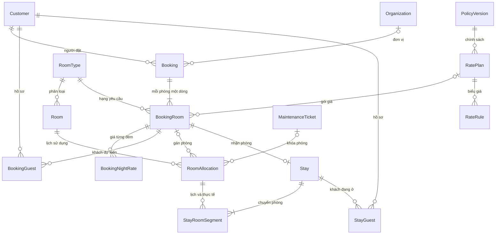
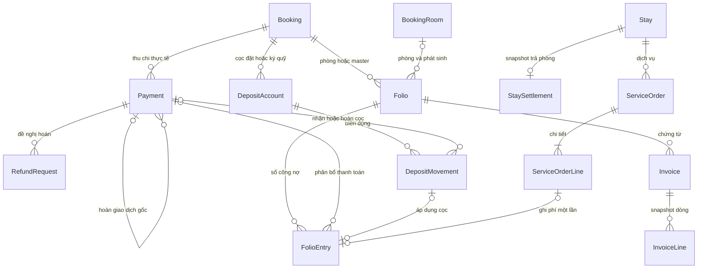

# Thiết kế database Sông Lam — bản lưu v1

**Tài liệu lịch sử.** Database đã được nâng cấp tới schema 3. Xem [hướng dẫn và ràng buộc hiện tại](README.md). Các mục ghi “chưa ràng buộc” dưới đây phản ánh v1, không phải trạng thái hiện tại.

Bản thiết kế ngày **08/11/2026**, dựa trên `js/data.js`, `js/store.js` và các mô hình chỉ đọc trong `js/pms-data.js`. Đây là nền dữ liệu cho backend tiếp theo. Giao diện HTML/CSS/JavaScript, localStorage và các nghiệp vụ đang chạy được giữ nguyên. Không tự nhập dữ liệu minh họa hoặc dữ liệu trình duyệt vào SQL Server.

Đã tạo database **`SongLamPms_Design`** trên **`.\SQLEXPRESS`**, SQL Server **2022 Express 16.0.1000.6**. Có **47 bảng**, bao gồm bảng phiên bản và ánh xạ chuyển đổi, **102 khóa ngoại**, 6 view, 2 thủ tục hỗ trợ kiểm tra quỹ phòng và 4 trigger bảo vệ lịch sử. Dữ liệu khởi tạo chỉ gồm **6 vai trò, 19 quyền** theo ma trận hiện tại; không có tài khoản/mật khẩu mặc định, khách hàng, phòng mẫu hay số liệu doanh thu.

## Tệp và cách chạy

| Tệp | Nội dung |
| --- | --- |
| [001_schema.sql](sqlserver/001_schema.sql) | Bảng, kiểu dữ liệu, khóa, CHECK, chỉ mục, phiên bản khởi tạo |
| [002_views_and_inventory.sql](sqlserver/002_views_and_inventory.sql) | Số dư folio/cọc, dòng tiền, doanh thu quyết toán, trạng thái phòng, quỹ phòng, khóa giao dịch, lịch sử bất biến |
| [003_reference_seed.sql](sqlserver/003_reference_seed.sql) | Ma trận quyền gốc, không tự cấp toàn quyền cho admin |
| [install.ps1](sqlserver/install.ps1) | Cài vào database mới; dừng nếu tên đã tồn tại |
| [generate_reference_seed.js](sqlserver/generate_reference_seed.js) | Tái sinh seed từ ma trận `roles` trong `js/data.js`; chỉ dùng khi chủ động cập nhật bản thiết kế |
| [run_database_tests.py](../tests/sqlserver/run_database_tests.py) | Kiểm thử trên SQL Server thật, database tạm riêng cho mỗi lần chạy |
| [fixture.sql](../tests/sqlserver/fixture.sql) | Dữ liệu kiểm thử tổng hợp, rollback sau từng ca |

Trong SQL Server Management Studio: kết nối `Database Engine`, server `.\SQLEXPRESS`, `Windows Authentication`, mở `Databases → SongLamPms_Design → Tables`. Các bảng thuộc schema `pms`.

Để cài một bản mới từ thư mục dự án:

```powershell
powershell -NoProfile -ExecutionPolicy RemoteSigned -File database/sqlserver/install.ps1 -Database SongLamPms_Dev -TrustServerCertificate
```

Database thiết kế hiện tại đã có, không chạy lại bộ tạo bảng vào đó. `001` và `003` cố ý dừng khi gặp schema/quyền đã tồn tại để bảo vệ dữ liệu và quyền đã tùy chỉnh. `002` có thể chạy lại khi phát triển định nghĩa. Những lần nâng cấp sau phải có migration riêng, backup và đối soát; không xóa rồi tạo lại database đang dùng.

`-ExecutionPolicy RemoteSigned` chỉ áp dụng cho tiến trình PowerShell này để chạy script cục bộ vừa tạo; không thay execution policy toàn máy.

Lệnh kiểm tra dữ liệu thiết kế:

```powershell
sqlcmd -S 'lpc:.\SQLEXPRESS' -E -C -d SongLamPms_Design -b -Q "SELECT Code, Name FROM pms.AppRole; SELECT * FROM pms.vFolioBalance;"
python tests/sqlserver/run_database_tests.py
```

`-C`/`-TrustServerCertificate` phục vụ SQL Server cục bộ đang dùng chứng chỉ tự ký; triển khai server thật cần cấu hình chứng chỉ tin cậy. Bộ kiểm thử cần `sqlcmd`, Python 3, Node.js, quyền tạo/xóa database tạm và đọc `sys.dm_tran_locks` cho ca hai kết nối. Nó chỉ xóa database `SongLamDesignTest_<UUID>` do chính lần chạy đó tạo thành công, không nhận tên database vận hành.

Ứng dụng hiện vẫn chạy bằng:

```powershell
python -m http.server 8080 --bind 127.0.0.1
```

Mở `http://127.0.0.1:8080/index.html`. SQL Server chưa được nối vào giao diện; không có API được giả lập là đã hoàn tất.

## Quy ước dữ liệu

- Một khách sạn Sông Lam, một đồng tiền VND; chưa thiết kế chuỗi đa cơ sở. `HotelSettings` chỉ cho phép một dòng `HotelId=1`.
- Khóa nội bộ dùng `bigint/int IDENTITY`; mã như đơn đặt, lượt ở, khách hàng, số phòng có cột `Code/Number` duy nhất. Không sinh mã nghiệp vụ bằng số ngẫu nhiên ngắn.
- Tiếng Việt dùng `nvarchar`, collation `Vietnamese_100_CI_AS`; các khóa idempotency/gateway phân biệt hoa thường bằng collation nhị phân.
- Tiền dùng `decimal(19,0)`, không dùng `float`. Số lượng dịch vụ có phần lẻ dùng `decimal(12,3)`; số tiền cuối làm tròn đến đồng. Thuế là snapshot theo chính sách được duyệt, không cài sẵn mức thuế giả định.
- Thời điểm có hậu tố `Utc` dùng `datetime2(3)` và lưu UTC. Ngày đến/trả theo khách sạn, đêm tính tiền và `BusinessDate` dùng `date`. Chuyển múi giờ tại biên API, không lấy ngày UTC làm ngày nghiệp vụ. Windows time zone là `SE Asia Standard Time`.
- Khoảng đặt/gán phòng là **[bắt đầu, kết thúc)**: kết thúc 12:00 và bắt đầu 12:00 không giao nhau. Thời gian vệ sinh cần được kiểm tra riêng trước nhận phòng, hoặc dành khoảng block có lý do.
- `rowversion` dùng phát hiện sửa đồng thời, **không phải ngày giờ**. API cập nhật `WHERE Id=@id AND RowVer=@version`, không có dòng cập nhật thì trả xung đột. [Tài liệu Microsoft](https://learn.microsoft.com/en-us/sql/t-sql/data-types/rowversion-transact-sql).
- Không cascade-delete dữ liệu tài chính/lưu trú. Danh mục có `IsActive`; hủy đơn lưu trạng thái và nhật ký. Bút toán, biến động cọc, snapshot trả phòng và audit chỉ được thêm; điều chỉnh bằng bản ghi liên kết.
- Số giấy tờ lưu ciphertext và HMAC phục vụ tìm kiếm, có phiên bản khóa. Khóa mã hóa/HMAC nằm ngoài database. Không dùng SHA trực tiếp cho số CCCD ít entropy. Không đưa giấy tờ hoặc mật khẩu vào audit JSON.

## Danh mục bảng và quan hệ chính

DDL là từ điển đầy đủ: từng cột, kiểu, NULL, default, FK, CHECK nằm trực tiếp trong `001_schema.sql`. Bảng sau giải thích mục đích và điểm nối chính.

| Nhóm | Bảng | Vai trò |
| --- | --- | --- |
| Cấu hình | `HotelSettings`, `BusinessDay`, `SchemaVersion` | Cấu hình một khách sạn; ngày nghiệp vụ và snapshot chốt ngày; phiên bản schema |
| Phân quyền | `AppUser`, `AppRole`, `Permission`, `UserRole`, `RolePermission` | Người dùng–vai trò–quyền nhiều–nhiều; tài khoản chưa có credential mặc định bị vô hiệu hóa |
| Khách | `Customer`, `CustomerIdentity`, `Organization` | Hồ sơ khách, giấy tờ được mã hóa, đơn vị thanh toán/xuất hóa đơn |
| Phòng | `RoomType`, `Room` | Hạng phòng, sức chứa, số phòng và vệ sinh; không lưu `currentStayId` hoặc `occupied` trùng nguồn |
| Giá | `PolicyVersion`, `RatePlan`, `RateRule` | Chính sách có phiên bản; giá ngày thường/cuối tuần/lễ; gói thuê giờ và block giờ phát sinh |
| Đặt phòng | `Booking`, `BookingRoom`, `BookingGuest`, `BookingNightRate` | Đơn lẻ/đoàn/walk-in; mỗi dòng con là một phòng được yêu cầu; khách dự kiến; giá snapshot từng đêm |
| Lịch | `RoomAllocation` | Gán phòng cụ thể hoặc block bảo trì theo thời gian; giữ lịch sử chuyển phòng |
| Lưu trú | `Stay`, `StayRoomSegment`, `StayGuest` | Một lượt ở cho một dòng đặt; các phòng thực tế đã ở; khách đồng hành và thời gian ở thực tế |
| Dịch vụ | `Service`, `ServiceOrder`, `ServiceOrderLine` | Danh mục; yêu cầu dịch vụ của lượt ở; số lượng/đơn giá snapshot |
| Ca thu ngân | `CashierShift` | Mở/đóng ca; tiền đầu ca, số đếm, số kỳ vọng và chênh lệch; một ca mở mỗi thu ngân |
| Thu/hoàn | `Payment`, `RefundRequest` | Dòng tiền thật vào/ra; yêu cầu, duyệt và liên kết khoản hoàn thành công về giao dịch gốc |
| Cọc | `DepositAccount`, `DepositMovement` | Cọc đặt phòng và ký quỹ lưu trú tách loại; nhận, hoàn, áp dụng, đảo áp dụng |
| Công nợ | `Folio`, `FolioEntry` | Folio phòng, phát sinh cá nhân và master; sổ chi phí/thu/hoàn/chuyển nội bộ |
| Quyết toán | `StaySettlement` | Snapshot bất biến khi trả phòng, phục vụ doanh thu đã quyết toán tương thích dashboard hiện tại |
| Hóa đơn | `Invoice`, `InvoiceLine` | Phiếu nội bộ/hóa đơn điện tử/điều chỉnh; thông tin người mua, dòng hàng và tiền thuế snapshot |
| Buồng phòng | `HousekeepingTask`, `MaintenanceTicket` | Dọn/kiểm tra vệ sinh; báo sự cố và xử lý; sự cố không tự động đồng nghĩa khóa bán phòng |
| Minibar | `MinibarAudit`, `MinibarAuditLine` | Kết quả kiểm kê; dòng tiêu thụ liên kết dòng dịch vụ để không ghi phí hai lần |
| Vận hành khác | `LostFound`, `ExceptionCase` | Đồ thất lạc; hồ sơ ngoại lệ và kết quả xử lý |
| Tích hợp | `ApiRequest`, `GatewayEvent` | Idempotency theo người dùng/thao tác/key, hash yêu cầu; chống xử lý lặp webhook |
| Lịch sử/chuyển đổi | `AuditLog`, `MigrationMap` | Nhật ký có actor/entity/request; ánh xạ ID cũ–mới, gồm trường hợp một đơn cũ tách nhiều dòng |

### ERD đặt phòng và lưu trú



`BookingRoom` thay `roomQuantity`: đặt 5 phòng tạo 5 dòng trong cùng transaction. Đơn đoàn có nhiều hạng/khoảng ngày trong cùng `Booking`, không tạo nhiều khách đoàn độc lập. Walk-in tạo `BookingKind=WALK_IN` rồi tạo lượt ở; đây là quy tắc chuẩn hóa của backend mới, không sửa hành vi trình duyệt hiện tại.

Một lượt ở có nhiều segment khi chuyển phòng. Hai unique filtered index bảo đảm một phòng chỉ có một segment chưa rời và một lượt chỉ ở một phòng hiện tại. `RoomAllocation` lưu lịch dự kiến; `StayRoomSegment` lưu hiện diện thực tế, vì khách quá giờ vẫn đang chiếm phòng dù khoảng dự kiến đã hết.

### ERD tài chính



Các ký hiệu một–nhiều mô tả nghiệp vụ; yêu cầu như “đơn phải có ít nhất một phòng”, “đơn dịch vụ phải có dòng” phải được backend bảo đảm khi commit, FK không ép được số con tối thiểu.

### Trạng thái và số liệu phòng

| Khía cạnh | Nguồn chuẩn | Giá trị |
| --- | --- | --- |
| Lưu trú thực tế | Segment chưa có `DepartedAtUtc` | `VACANT`, `OCCUPIED` |
| Vệ sinh | `Room.CleanStatus` | `CLEAN`, `DIRTY`, `CLEANING`, `INSPECTING` |
| Khai thác tại thời điểm hiện tại | `Room.IsActive` và block đang hiệu lực | `ACTIVE`, `MAINTENANCE`, `INACTIVE` |
| Nhu cầu đặt phòng | `BookingRoom` và gán phòng theo khoảng | `HELD`, `CONFIRMED`, `IN_HOUSE` chiếm quỹ phòng |

`vRoomStatus` tách ba trạng thái. “Trống sạch” phải `VACANT + CLEAN + ACTIVE`. Sự cố có thể chỉ là việc cần sửa; muốn ngừng khai thác phải tạo block. Khi xử lý xong bảo trì, đóng interval block, không xóa lịch sử. Trạng thái phòng không tự đổi thành sạch khi khách trả.

`vInventoryDemand` không cộng hai lần đơn và phòng đã gán. Nó chia khoảng theo ranh giới gán/chuyển; đoạn chưa gán dùng hạng đặt, đoạn đã gán dùng hạng phòng thực tế. Nhờ vậy nâng hạng/chuyển khác hạng tiêu thụ đúng quỹ phòng. `HELD` hết hạn vẫn giữ chỗ cho tới khi worker chuyển trạng thái trong transaction; không âm thầm bỏ chỗ chỉ vì đồng hồ thay đổi.

## Chống đặt trùng và giao dịch backend

Khóa ngoại/CHECK không phát hiện mọi khoảng thời gian giao nhau. Hai thủ tục hỗ trợ đã có, nhưng **chưa phải API tạo đặt phòng/nhận phòng hoàn chỉnh**. Backend bắt buộc dùng cùng giao thức cho tạo đơn, đoàn, gán/chuyển phòng, gia hạn, trả sớm, hủy, block và sửa sức chứa/phòng:

```sql
SET XACT_ABORT ON;
SET TRANSACTION ISOLATION LEVEL READ COMMITTED;
BEGIN TRY
    BEGIN TRANSACTION;
    EXEC pms.usp_LockInventory; -- trước mọi truy vấn/ghi quỹ phòng
    -- Kiểm tra quyền, rowversion, chính sách và trạng thái.
    -- Ghi đầy đủ tất cả dòng của thao tác; không commit từng phòng trong đoàn.
    EXEC pms.usp_AssertInventory;
    -- Ghi AuditLog trong cùng transaction.
    COMMIT;
END TRY
BEGIN CATCH
    IF XACT_STATE() <> 0 ROLLBACK;
    THROW;
END CATCH;
```

Khóa toàn quỹ phòng của **một khách sạn**, đơn giản và phù hợp giai đoạn đầu; không giữ khóa khi chờ khách nhập form hoặc gọi cổng thanh toán. Khi tải lớn có thể chia khóa theo hạng/khoảng nhưng phải khóa theo thứ tự xác định và kiểm chứng lại nâng hạng/chuyển phòng. Khóa `sp_getapplock` thuộc transaction được giải phóng khi commit/rollback; phải xử lý return code âm. [Microsoft: sp_getapplock](https://learn.microsoft.com/en-us/sql/relational-databases/system-stored-procedures/sp-getapplock-transact-sql).

Thủ tục assert phát hiện phòng gán bị vô hiệu hóa, gán ngoài khoảng, hai phân bổ giao nhau, một dòng đơn được gán hai phòng cùng thời điểm và nhu cầu cộng dồn vượt sức chứa (kể cả đơn chưa gán và block). Thuật toán cộng tại từng mốc bắt đầu/kết thúc, không đếm thô tất cả đơn giao một dải ngày. Không dùng transaction `SNAPSHOT` cho luồng này. Tài khoản ứng dụng sau này không được ghi trực tiếp để bỏ qua giao thức; chỉ cấp quyền cho các endpoint/thủ tục nghiệp vụ đã hoàn thiện. **Bản này chưa tạo login hay cấp quyền ghi backend.**

Các kiểm tra trạng thái và tài chính dưới đây vẫn cần triển khai trong API; không coi việc tạo bảng là đã có nghiệp vụ server:

| Luồng | Transaction cần bảo đảm |
| --- | --- |
| Tạo đơn/đoàn | Toàn bộ dòng hoặc rollback; sức chứa người, ngày và giá chính sách; giữ snapshot giá; cộng dồn tất cả dòng cùng hạng/khoảng |
| Nhận phòng/nhận sớm | Đơn còn hiệu lực; phòng sạch, đang khai thác, không có segment hiện tại; kiểm tra khoảng nhận sớm; gắn đúng allocation và booking room; tạo Stay/khách/segment cùng lúc |
| Chuyển phòng | Đóng segment cũ, làm bẩn phòng cũ, kết thúc allocation cũ, mở allocation/segment mới; kiểm tra phòng nhận sạch và không có khách; giá thay đổi phải có dấu vết |
| Thuê giờ/gia hạn | Tính block giờ theo snapshot; cập nhật khoảng, kiểm tra cam kết đặt tiếp theo trước commit; kiểm tra hiện diện thực tế của khách quá giờ |
| Trả sớm/trả phòng | Áp dụng chính sách đã chốt, kiểm minibar; bút toán/thu/hoàn đúng; đóng segment, tạo việc dọn, lưu snapshot; không xóa nợ master; hoàn cọc pending không tự giữ phòng occupied |
| Dịch vụ/minibar | Ghi phí một lần theo `ServiceOrderLineId`; hủy bằng bút toán điều chỉnh; thanh toán ngay vẫn phải có phí và khoản thanh toán tương ứng |
| Thu tiền | Idempotency key + request hash; xác minh gateway trên server; `Payment` chỉ thành công khi thực thu được xác nhận; ledger phải cùng booking và số tiền phân bổ không vượt khoản thu |
| Hoàn tiền | Quyền đề nghị/duyệt/thực hiện; khóa giao dịch gốc; tổng đã hoàn + đang được giữ chỗ hoàn không vượt khoản thu; đúng original payment/booking/amount; chỉ completed khi payout thành công |
| Cọc | Khóa tài khoản cọc; số dư không âm; receive/refund khớp Payment đã thành công; apply/unapply khớp đúng một FolioEntry; không chi tiêu cùng tiền hai lần |
| Chuyển master | Hai FolioEntry cùng TransferPairId, khác folio nhưng cùng booking, cùng amount, đối dấu; chặn cặp thiếu và cặp không cân; không sinh Payment |
| Hóa đơn | Tổng các dòng bằng header; snapshot thuế/khách mua; chỉ phát hành điện tử sau phản hồi nhà cung cấp; khóa sửa chứng từ đã phát hành và tạo chứng từ điều chỉnh |
| Chốt ca/ngày | Khóa ngày đang mở và expectedWorkingDate; đối soát khoản thành công, không bỏ giao dịch pending; snapshot, no-show/overstay, mở ngày mới và HotelSettings trong cùng commit |

Ràng buộc nhiều bảng như tổng hoàn, tổng phân bổ Payment, số dư cọc không âm, cặp chuyển cân và đóng folio số dư 0 **chưa được tự động ép bởi DDL**. Cần khóa `UPDLOCK/HOLDLOCK` trên các bản ghi tài chính liên quan theo thứ tự ổn định, kiểm tra tổng và commit nguyên tử. Không dùng kiểm tra ở trình duyệt thay cho các bước này.

## Folio, cọc, doanh thu và công nợ

`FolioEntry` là sổ phụ công nợ khách, không phải hệ thống kế toán tổng hợp bút toán kép. `SignedAmountVnd` do database tính; dương làm tăng nợ khách:

| Loại | Dấu số dư | Ý nghĩa |
| --- | --- | --- |
| `CHARGE` | + | Tiền phòng, dịch vụ, phụ thu, phí hủy |
| `CHARGE_CREDIT` | − | Giảm giá/đảo chi phí, có lý do và liên kết khi đảo |
| `PAYMENT` | − | Khoản thu thực tế phân bổ vào folio |
| `REFUND` | + | Hoàn khoản thanh toán đã phân bổ |
| `TRANSFER_DEBIT` / `TRANSFER_CREDIT` | + / − | Chuyển nợ giữa folio, không phải thu/chi/doanh thu mới |
| `DEPOSIT_APPLY` / `DEPOSIT_UNAPPLY` | − / + | Áp dụng/đảo áp dụng cọc, không phải tiền vào/ra mới |

Cọc đặt phòng có thể ở tài khoản chung của đơn hoặc theo dòng phòng; ký quỹ `GUARANTEE` phải gắn dòng phòng. Khoản nhận/hoàn có Payment; áp dụng cọc chỉ có biến động nội bộ và FolioEntry. Cọc đoàn được phân bổ theo đồng nguyên, phần dư xử lý xác định, tổng sau phân bổ phải bằng tổng gốc.

- `vCashFlowDaily`: chỉ Payment thành công, thu trừ hoàn; cho phép âm, bao gồm cọc thực thu/hoàn. Không phải doanh thu.
- `vSettledRevenueDaily`: snapshot StaySettlement theo ngày quyết toán. Giữ định nghĩa doanh thu đã quyết toán của dashboard hiện tại; chưa phải doanh thu kế toán dồn tích từng đêm.
- `vFolioBalance`: toàn bộ bút toán, không phụ thuộc Stay đã trả hay chưa. Công nợ hiển thị là tổng **số dư dương từng folio**; số dư âm là tiền trả thừa, hiển thị riêng, không bù trừ tùy tiện giữa khách.
- `vDepositBalance`: receive + unapply − apply − refund. Số dư cọc không tự trừ công nợ cho tới khi đã có apply.
- Khách đến/trả hôm nay truy vấn `BookingRoom.ArrivalDate`/`DepartureDate` theo trạng thái; lượt đang ở đến hạn trả theo `Stay.ExpectedOutAtUtc` đã đổi sang giờ khách sạn. Ngày nghiệp vụ lấy `HotelSettings.WorkingDate`.
- Snapshot cũ lúc chốt ngày gọi tiền thuần là `netRevenue` có thể bị chặn âm. Khi chuyển đổi phải giữ bản gốc để đối soát và tính lại cash flow từ giao dịch; không dùng trường này làm doanh thu chuẩn.

## Ánh xạ từ dữ liệu hiện tại

| Collection/trường hiện tại | Đích | Cách chuyển |
| --- | --- | --- |
| `hotelInfo` | HotelSettings + BusinessDay | Làm sạch cấu hình minh họa, xác minh ngày nghiệp vụ; không nhập MST mô phỏng thành MST thật |
| `roomClasses` | RoomType + RateRule | Giữ code/sức chứa/tiện nghi; tách base/weekend/holiday thành quy tắc giá |
| `policies` | PolicyVersion + RatePlan | Lưu phiên bản đúng chính sách đang áp dụng; không viết lại giá của lịch sử |
| `rooms` | Room + RoomAllocation | cleanStatus giữ riêng; currentStayId đối soát với Stay/segment; maintenance thành block có khoảng được xác nhận |
| `bookings`, `groupBookings` | Booking + BookingRoom + BookingNightRate | Đoàn gộp header, tách mỗi phòng một dòng; mỗi ID cũ có MigrationMap; không nhân đôi header và đơn con |
| `assignedRooms`, `checkedInRooms` | RoomAllocation + StayRoomSegment | Đối chiếu timeline và lượt ở thực tế trước khi nhập |
| `stays`, guest/guests | Stay + StayGuest + Customer | Chuẩn hóa khách; không suy ra hai người là một chỉ vì cùng tên/số điện thoại |
| `stays.nightlyRates`, thuê giờ | BookingNightRate + PricingSnapshotJson | Giữ giá đêm và điều khoản thuê giờ đã chốt, không tính lại bằng giá danh mục mới |
| `services`, `servicesUsed`, surcharge/discount | Service + ServiceOrder/Line + FolioEntry | Giữ giá lịch sử; bỏ trùng khi một chi phí đã có trong snapshot |
| `transactions` | Payment, DepositMovement, FolioEntry | Phân loại tiền thật và nội bộ; `isInternalAllocation`, chuyển master, khấu trừ ký quỹ không tạo tiền thật |
| `depositAmount`, allocated/guarantee fields | DepositAccount + DepositMovement | Đối soát nguồn thu/áp dụng/hoàn; không cộng lại các trường tổng hợp thành nhiều khoản thu |
| `billedToMaster`, masterFolio | Folio MASTER + cặp chuyển | Giữ nợ sau checkout, không ép số dư bằng 0 |
| `folioSnapshot` | StaySettlement + sổ chi tiết đã đối soát | Snapshot chỉ là chứng cứ, không ghi phí kép từ cả chi tiết và tổng snapshot |
| `refundRequests` | RefundRequest + Payment OUT | Giữ trạng thái đang chờ, không tự đánh dấu completed |
| `housekeepingTasks`, `maintenanceTickets` | Các bảng cùng nghĩa | Đối chiếu người phụ trách, thời điểm, trạng thái |
| `minibarAudits`, `lostAndFound`, `exceptionCases` | Các bảng cùng nghĩa | Liên kết lượt ở/phòng/dịch vụ gốc |
| `roles`, `users`, `auditLogs` | RBAC + AppUser + AuditLog | Chuyển mã quyền đúng ma trận; không tạo password từ username; tài khoản phải kích hoạt qua backend |
| `cashierShifts`, `dailyLedgers` | CashierShift + BusinessDay | Giữ lịch sử, tính lại theo giao dịch để đối soát, tách doanh thu và dòng tiền |

Quy trình nhập về sau: xuất và lưu bản sao localStorage của origin đúng → lưu checksum/dataset ID → kiểm tra ngày, trùng ID, guest và giao dịch không có nguồn → staging → ánh xạ khóa → nhập trong các lô có transaction/idempotency → so sánh số phòng/lượt ở/quỹ phòng/từng folio/cọc/thu/hoàn → mới chuyển API và có phương án quay lại. Ngày giờ cũ không có múi giờ phải được diễn giải theo Asia/Ho_Chi_Minh, không gắn `Z` trực tiếp. Dòng thiếu lịch sử hoặc không cân phải báo lỗi đối soát, không chế ra giao dịch bù.

**Chưa viết/chạy công cụ nhập localStorage.** `MigrationMap` chuẩn bị truy vết; không chứng minh dữ liệu đã được chuyển.

## Kiểm thử và phần tiếp theo

Kết quả thực chạy và giới hạn kiểm tra được ghi tại [VALIDATION.md](VALIDATION.md).

Backend tiếp theo cần có đăng nhập và RBAC server, API theo các transaction ở trên, scheduler xử lý hold/night audit, quản lý khóa bí mật, kết nối ngân hàng/hóa đơn thật khi có hợp đồng/API, xuất báo cáo và công cụ migration/đối soát. Những phần này **chưa triển khai trong đợt thiết kế database**. Chưa chọn framework backend thay cho người dùng; frontend đang có được giữ nguyên và sẽ nối qua API.
