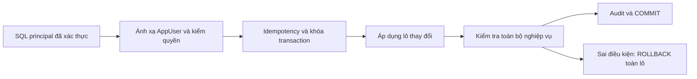

# Database Sông Lam — ràng buộc nghiệp vụ bắt buộc

Bản nâng cấp ngày **08/11/2026**, database **`SongLamPms_Design`**, server **`.\SQLEXPRESS`**, phiên bản schema cuối **3**. Giữ 47 bảng nền, bổ sung 4 bảng kiểm soát; không xóa database hay thay `js/store.js`. Migration 2 xây dựng cổng giao dịch; migration 3 bổ sung lý do hủy đơn bắt buộc đúng nghiệp vụ hiện tại.

**51 bảng · 108 khóa ngoại · 122 CHECK · 28 trigger · 7 thủ tục.** Có 30 loại lệnh và 100 quy tắc ghi. Ma trận 6 vai trò/19 quyền hiện có được giữ nguyên.

Giao diện vẫn dùng **localStorage**. Đợt này hoàn thiện lớp kiểm soát dữ liệu SQL; chưa xây HTTP backend, chuyển dữ liệu hay nối các màn hình vào SQL Server.

## Trình tự thực hiện

1. Rà soát schema và các hàm nghiệp vụ trong `js/store.js`.
2. Ràng buộc quỹ phòng, giá, lưu trú, dịch vụ và minibar.
3. Ràng buộc thu/hoàn tiền, cọc, folio, quyết toán và chốt ca/ngày.
4. Khóa quyền ghi trực tiếp; thêm xác thực SQL principal, RBAC, rowversion, idempotency và audit.
5. Kiểm thử trên database tạm, gồm hai kết nối cùng sử dụng một khoản cọc.
6. Backup có checksum, kiểm tra backup, áp dụng migration và xác minh database thật.

[ERD, danh mục bảng nền và ánh xạ localStorage v1](DESIGN_V1.md) được giữ làm tài liệu lịch sử. Xem [kết quả xác minh bản nâng cấp](VALIDATION_V2.md).

## Quy tắc được bắt buộc kiểm tra

| Nhóm | Ràng buộc |
| --- | --- |
| Đặt phòng/đoàn | Đơn phải có phòng; đủ sức chứa; ngày địa phương khớp UTC; tất cả dòng cùng commit hoặc rollback; hủy phải có lý do |
| Quỹ phòng | Tính cả phòng chưa gán; không vượt sức chứa; không gán trùng phòng/khoảng; bảo trì làm giảm quỹ phòng; nâng hạng dùng sức chứa hạng thực tế |
| Giá | Có rate plan/policy; đủ giá từng đêm và tổng đúng; thuê giờ đúng block; thay giá công bố cần quyền sửa giá và lý do; snapshot sau trả phòng không được sửa |
| Nhận/chuyển phòng | Phòng sạch, active, không bảo trì; allocation đúng dòng đặt; một lượt đang ở mỗi phòng; một phòng hiện tại mỗi lượt; có khách đại diện |
| Gia hạn/trả sớm | Khoảng mới, allocation, expected checkout và giá phải nhất quán; không lấn đơn khác; thay tổng tiền phòng phải có bút toán tương ứng |
| Dịch vụ | Đúng đơn giá danh mục; giao dịch vụ phải có phí đúng dòng/lượt ở; không ghi hai lần; hủy phải có lý do và credit liên kết |
| Minibar/trả phòng | Kiểm kê confirmed cho các phòng đã ở; hàng tiêu thụ có dịch vụ tương ứng; không để nợ cá nhân dương; snapshot khớp phí; tự làm bẩn phòng và tạo việc dọn |
| Thu tiền | Tiền dương; tiền mặt cần ca mở của đúng thu ngân; tiền thành công phải phân bổ đúng tổng; pending/failed không được sử dụng như tiền đã thu |
| Hoàn tiền | Đúng giao dịch gốc và nơi phân bổ; tổng hoàn + đang chờ không vượt nguồn; đề nghị → duyệt → hoàn; payout khớp tiền/đơn/nguồn; replay không trả hai lần |
| Cọc | Không âm; không dùng phần đang chờ hoàn; receive/refund có tiền thật; apply/unapply có bút toán khớp; đảo đúng số tiền gốc, chỉ một lần |
| Folio đoàn | Hai bên chuyển cân tiền, khác folio, cùng booking; không chuyển quá nợ nguồn; không sinh tiền thật; nợ master còn sau khi khách rời phòng |
| Đóng folio | Không đóng khi còn nợ hoặc tiền trả thừa; không ghi thêm vào folio đã đóng |
| Phiếu nội bộ | Tổng dòng bằng header; giá/thuế đối soát; đúng phí và folio; không phát hành lặp cùng khoản; không sửa chứng từ đã phát hành |
| Chốt ca/ngày | Đối soát tiền; ca của đúng thu ngân; lệch kiểm đếm có lý do; hết pending; ngày tiến đúng một ngày; snapshot/no-show/ngày mới nguyên tử; replay không nhảy ngày |
| Quyền/lịch sử | Kiểm quyền từng dòng thao tác/tài nguyên đọc; actor từ principal thật; không sửa/xóa lịch sử tài chính; audit cùng transaction |

Các kiểm tra nhiều bảng nằm trong `usp_AssertBusinessState` và được **gọi bắt buộc trước commit**, không phụ thuộc frontend có nhớ gọi hay không. Khóa được lấy trước đọc/ghi để hai lệnh không cùng kiểm tra trên số dư/quỹ phòng cũ.

## Cổng đọc/ghi và chống bỏ qua ràng buộc



- Vai trò SQL **`pms_executor`** bị DENY đọc/ghi trực tiếp và ALTER schema. Chỉ được gọi `pms.usp_ExecuteCommand` và `pms.usp_Query`.
- **24 trigger CommandOnly** chặn ghi vòng vào bảng nghiệp vụ, kể cả lệnh chỉ lấy application lock rồi ghi trực tiếp. Thêm 4 trigger bất biến từ v1 thành 28 trigger.
- `CommandExecution` chỉ tồn tại trong transaction. Không dùng `SESSION_CONTEXT` do client tự đặt làm bằng chứng danh tính.
- Wrapper công khai ánh xạ SID database principal → AppUser. Module có quyền ghi là riêng tư; không nhận ActorId từ client và không mặc định admin có mọi quyền vận hành.
- JSON là tham số; tên bảng/cột phải thuộc allowlist quản trị. Các cột actor, ngày nghiệp vụ, RequestId được cổng SQL đặt.
- DBA/sysadmin vẫn có thể đổi quyền, tắt trigger hoặc sửa thủ tục. **Không cấp db_owner/sysadmin cho tài khoản ứng dụng.** Đây không phải cơ chế chống quản trị viên cố tình vô hiệu hóa bảo vệ.

Một khóa ghi chung cho một khách sạn ưu tiên tính đúng đắn. Chưa tối ưu cho chuỗi nhiều cơ sở hoặc tải rất lớn; chưa đo tải sản xuất.

## Cài đặt và nâng cấp

Database trên máy đã được nâng cấp, không cần chạy lại. Xem trong SSMS: `.\SQLEXPRESS → Databases → SongLamPms_Design`.

```powershell
# Cài mới: tên database phải chưa tồn tại.
powershell -NoProfile -ExecutionPolicy RemoteSigned -File database/sqlserver/install.ps1 -Database SongLamPms_Dev -TrustServerCertificate

# Nâng một database đang ở schema 1 hoặc 2.
powershell -NoProfile -ExecutionPolicy RemoteSigned -File database/sqlserver/upgrade.ps1 -Database SongLamPms_Dev -TrustServerCertificate
```

Upgrade kiểm tra phiên bản, tạo backup `COPY_ONLY,CHECKSUM`, chạy `RESTORE VERIFYONLY`, rồi áp dụng migration theo thứ tự. **004–007 chung một kết nối/transaction**, tạo schema 2; **008 là transaction kế tiếp**, tạo schema 3. Nếu một migration lỗi, migration đó rollback; các phiên bản trước đã hoàn tất được giữ lại để kiểm tra. Không tự restore đè hoặc xóa dữ liệu. Dữ liệu cũ không đáp ứng quy tắc mới phải được đối soát, không tự tạo giao dịch bù hoặc lý do hủy giả.

`RESTORE VERIFYONLY` xác minh bản backup, không thay thế diễn tập restore thực tế. `RemoteSigned` chỉ cho tiến trình PowerShell hiện tại; `TrustServerCertificate` dành cho instance cục bộ. Script dùng tệp SQL tạm UTF-8 và chỉ xóa đúng tệp tạm nó tạo.

## Giao ước dành cho backend

Đọc: `EXEC pms.usp_Query @Entity='Room', @Offset=0, @Limit=100`. Tối đa 200 dòng mỗi lần. Cột `Version` là chuỗi hex 18 ký tự dùng cập nhật có kiểm tra xung đột. Danh sách AppUser không trả password hash/external subject; giấy tờ định danh không nằm trong API đọc chung.

Ghi theo lô JSON, ví dụ giao ước — **không phải dữ liệu đã nhập vào database**:

```sql
EXEC pms.usp_ExecuteCommand
 @Operation='CUSTOMER', @IdempotencyKey='uuid-do-backend-tao',
 @Changes=N'[{"entity":"Customer","verb":"insert","ref":"newCustomer",
              "values":{"Code":"MA-KHACH-THUC-TE","FullName":"Tên khách thực tế"}}]';
```

Mỗi lô 1–500 thay đổi. `ref` đặt tên cho ID mới; dòng sau dùng `"BookingId":"$newBooking"`. Update/delete truyền đủ `key`; bảng có rowversion phải có `version` vừa đọc. Lịch sử không có quyền update/delete. Cùng actor/operation/key và payload trả kết quả cũ; khác payload bị từ chối. Backend cần giữ nguyên serialization JSON khi retry vì hash hiện dựa trên chuỗi JSON nhận được.

30 operation: `BOOKING`, `CANCEL_BOOKING`, `ASSIGN_ROOM`, `CHECK_IN`, `CHANGE_STAY`, `TRANSFER_ROOM`, `CHECK_OUT`, `SERVICE`, `CANCEL_SERVICE`, `ADJUST_CHARGE`, `MINIBAR`, `COLLECT`, `CANCEL_PAYMENT`, `APPLY_DEPOSIT`, `TRANSFER_FOLIO`, `REQUEST_REFUND`, `APPROVE_REFUND`, `COMPLETE_REFUND`, `CLOSE_FOLIO`, `SHIFT`, `CLOSE_DAY`, `RECEIPT`, `CLEANING`, `MAINTENANCE`, `BLOCK_ROOM`, `LOST_FOUND`, `EXCEPTION`, `CUSTOMER`, `CONFIG`, `RBAC`.

BOOKING phải gửi đủ header/phòng/giá; CHECK_IN gửi Stay/guest/segment/phí và cập nhật dòng đặt; CHECK_OUT đóng segment/guest/stay, tạo settlement và hoàn tất dòng đặt. Thiếu hoặc không cân thì toàn lô thất bại. Thu/hoàn tiền thực hiện trước checkout; tiền đã thực thu không bị xóa khi checkout còn thiếu minibar. Phiếu nội bộ tạo DRAFT, thêm dòng rồi phát hành ISSUED.

## Phần chưa nối vào hệ thống

- Chưa có HTTP backend hoặc chuyển localStorage. Các nghiệp vụ JavaScript vẫn giữ nguyên, chưa sử dụng cổng SQL mới.
- Database thật chưa có người dùng vận hành, principal binding, cấu hình khách sạn/ngày làm việc, phòng và bảng giá thật. DBA khởi tạo sau khi chốt xác thực backend; không tạo mật khẩu mặc định. Gán SQL principal vào `pms_executor` và ánh xạ SID qua `PrincipalBinding`; không tin ActorId gửi từ trình duyệt. Connection pool phải giữ đúng danh tính đã xác thực.
- Giá đêm/gói giờ có kiểm tra bảng giá và override. **Việc tự tính mọi phụ thu nhận sớm/trả muộn, phí hủy và ngoại lệ theo mô tả chính sách cũ chưa được chuyển trọn vẹn sang SQL.** Điều chỉnh ngoài giá phòng hiện qua `ADJUST_CHARGE`, quyền `systemConfig` và audit. Backend phải chuyển/đối chiếu các hàm chính sách trước khi nối UI; không xem JSON chính sách là bộ máy tự tính phí.
- Thanh toán bên ngoài chỉ được pending/hủy pending; không ép thành công khi chưa có xác thực cổng. Hóa đơn điện tử bị chặn phát hành; RECEIPT chỉ là phiếu nội bộ. Chưa kết nối ngân hàng/nhà cung cấp hóa đơn.
- Chưa có scheduler tự hết hạn hold, kiểm thử tải sản xuất hoặc diễn tập khôi phục backup. Không tuyên bố các phần này đã hoàn thành.

## Tệp và kiểm thử

| Tệp | Nội dung |
| --- | --- |
| `sqlserver/004_business_contract.sql` | Bảng kiểm soát, nguồn hoàn, state machine và allowlist |
| `sqlserver/005_business_validation.sql` | Kiểm tra trạng thái cuối của transaction |
| `sqlserver/006_command_gateway.sql` | Cổng đọc/ghi, quyền, idempotency, rowversion, audit |
| `sqlserver/007_enforce_access.sql` | Trigger chặn ghi vòng, vai trò SQL, hoàn tất schema 2 |
| `sqlserver/008_cancellation_reason.sql` | Lý do hủy bắt buộc, hoàn tất schema 3 |
| `sqlserver/install.ps1`, `sqlserver/upgrade.ps1` | Cài mới/nâng cấp có backup |
| `../tests/sqlserver/run_v2_tests.py` | Kiểm thử cổng nghiệp vụ bằng SQL Server thật |

```powershell
python tests/sqlserver/run_v2_tests.py
node tests/view-data.test.js
# Sau khi khởi động HTTP server:
python run_suite.py
python run_ui_checks.py
```

Ứng dụng chạy bằng `python -m http.server 8080 --bind 127.0.0.1`, mở `http://127.0.0.1:8080/index.html`.

Tham khảo kỹ thuật: [Microsoft: ownership chain/EXECUTE AS](https://learn.microsoft.com/en-us/sql/t-sql/statements/execute-as-clause-transact-sql), [sp_getapplock theo transaction](https://learn.microsoft.com/en-us/sql/relational-databases/system-stored-procedures/sp-getapplock-transact-sql).
